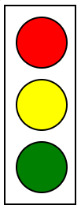

# Practice Questions

## Qn 1.

Recreate the given image:

- Create a div and 3 sibling divs inside it
- For the outer div, set the following styling:
    - height 200px, width 70px and border to 2px solid black
- For the inner divs, set the following styling:
    - height 50px, width 50px and border to 2px solid black color
    - Also set margin 10px
    - Make the inner divs circular and give them individual colors (red, yellow and green)

## Qn 2.

Create a box using a div.

Set:

- Its height to 150px, width to 300px and the background color to grey.
- Border to a 5px black dotted border.
- A top margin of 20px.
- A right margin of 1em.
- A bottom margin of 40px.
- A left margin of 2em.
- Padding on all sides of 1em.

## Qn 3.

Create 3 divs with the following properties:

- Height and width of 100px
- Set the background color to pink
- Set the border to 2px solid black
- Make these divs circular
- Place all 3 divs in a single line

## Qn 4.

Create a list of technologies - HTML, CSS, JavaScript, Node.js, React, SQL, MongoDB, Java, C++, C and Python.

Change the display of all list items to inline to place them all on a single line.

Did you notice anything different? Find out why the bullet points disappear.
