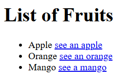

# Practice Questions

## Qn 1.

Create an unordered list of 3 fruits - apple, orange and mango that also shows links to their pictures.



## Qn 2.

Create a portfolio page.

- Add name and picture on top.
- Add sections for education, skills, hobbies and contact.

## Qn 3.

Use the correct HTML tag to add a paragraph with the text "Hello World!".

## Qn 4.

Mark up the text with appropriate tags:

- "Hello" is the most important heading.
- "Hello, World!" is the next most important heading.
- "Hello, world! Keep growing." is the third most important heading.
- The last sentence "Hello, world! Keep growing daily." is just a paragraph.

Start with the most important heading (the largest) and end with the least important (the smallest).

## Qn 5.

Create a clickable link that redirects to the url: [https://www.java.com/en/](https://www.java.com/en/)

## Qn 6.

You are given the rank list of a few students. Create an ordered HTML list to display the following list:

```text
1. Jomon
2. Krishna
3. Nikku
4. Yoco
5. Kelly
```
